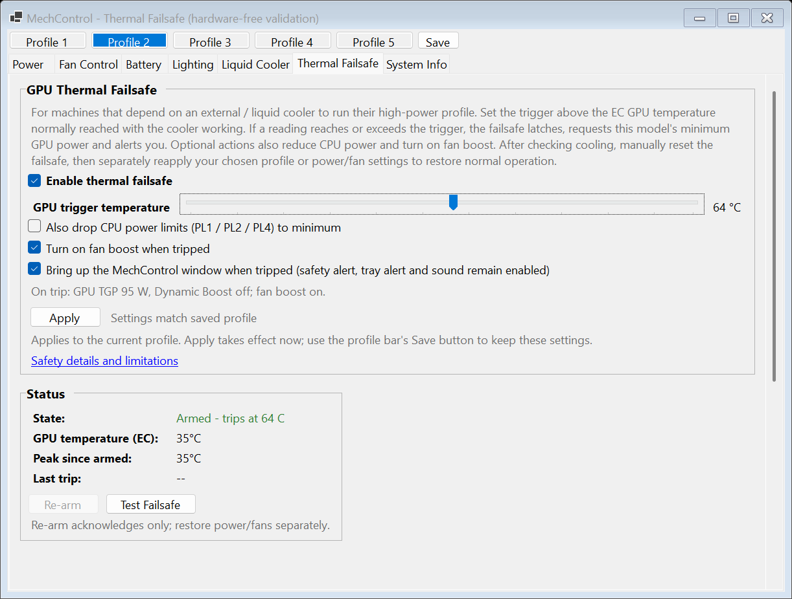

# Thermal Failsafe Validation

## Scope

Initial implementation was verified locally without subagents, deployment,
EC/HID/BLE access, or deliberate hardware protection tests. Existing dirty failsafe work was retained
and extended. The supplied screenshot controls appearance; the handoff plan's
immediate-trigger/manual-reset safety semantics override its inaccurate delay and
automatic-rearm wording.

**2026-09-08 final update: functional verification completed.** The final live
completion run passed, followed by the safety/UI suites and release/packaged checks.
The earlier automatic-wake attempt failed and is not certified; see coverage limits
and the chronological session record below. The expanded build is not deployed.

## Baseline And Regression Work

- Original hardware-free suite: **16/16 passed**.
- Added failing regressions first: disabled reset-pending enforcement, fresh
  enforcement failure at reset, and subscriber exceptions interrupting protection.
  Baseline with regressions: **16/19 passed**, all three new failures reproduced.
- Extended controller/real guard/real settings-manager suite: **32/32 passed**.
  It includes stage/action/threshold recovery matrices; real committed/pending,
  corrupt/null/legacy files and interrupted atomic replacement; partial/individual
  restoration and failed durable release; automatic versus deliberate applies;
  conservative profile transition failures; firmware-default policy; optional
  action failures; Intel/AMD CPU encoding/temperature preservation; actual fan
  verification failures; and interleaved EC reactivation/enforcement during release.
- Profile Save authorization is tested in the controller; UI tests verify saving
  reads applied configuration and does not clear unapplied edits.

## UI And Sampling

`tests/ThermalUi.Tests` compiles the real `FailsafeTab` and `EcMonitor` with a fake EC. It never constructs the hardware application MainForm.

- Visible/tray ticks use one shared GPU sample with protection, sampled first.
  Disabled/unheld tray mode adds no GPU read; ordinary visible telemetry still
  reads its normal sample. Broken subscribers and repeated unrelated telemetry
  failures do not suppress the safety subscriber or stop the shared timer.
- Pending edits survive samples/refresh; Save reads runtime settings. Test is
  disabled while tripped and reset-pending. Unsupported controls remain gated.
  The real slider takes focus and processes one-degree left/right keyboard input.
- Eight states rendered: disabled, armed, pending edits, applied-unsaved, verified
  trip, incomplete trip, reset-pending, and unsupported.
- Actual native **144 DPI / 150%** captures were inspected, including narrow-width
  wrapping. A clipped checkbox at native DPI was found and corrected by measuring
  its multiline text instead of relying on CheckBox.AutoSize/MaximumSize.
- Additional **100/150/200% simulated font/geometry** captures exercise resizing,
  scrolling and long diagnostics. They are not native 100/200 per-monitor DPI
  certification. Scroll-position captures expose long status/history and buttons.
- Representative images and visual comparison notes are in
  [`screenshots/thermal_failsafe`](../screenshots/thermal_failsafe/README.md).

Native screenshot example:



## Packaging

The Windows release script builds framework-dependent and trimmed self-contained
packages successfully: zero errors and only the two existing MainForm `CS8602`
warnings. No `System.Windows.Extensions` dependency was reintroduced. The final
packaged-alert smoke test passed, including both foreground preference branches.

The packaged smoke harness substitutes only the entry assembly in a scratch copy
of the shipped package, loads the real app assembly as its target and calls the
real notification method without running MainForm's hardware constructor. It tests
native sound invocation, topmost nonmodal alert and timer/message-loop progress,
and both foreground preferences via an activation callback. This verifies the
preference branch, not full hardware-app activation/startup.

## Reproduction

On this workstation the SDK executable is `C:/Users/Jon/.dotnet/dotnet.exe`; use
`dotnet` below when it is on PATH.

```powershell
dotnet run --project tests/GpuFailsafe.Tests
dotnet run --project tests/ThermalUi.Tests -- C:/Temp/tandem/thermal-ui-validation
dotnet run --project tests/ThermalUi.Tests -- C:/Temp/tandem/thermal-ui-native --native
dotnet build MechControl/MechControl.csproj -c Release
powershell -ExecutionPolicy Bypass -File MechControl/build-scripts/build-release.ps1
./tests/packaged-alert-smoke.ps1 -Package ./MechControl/bin/selfcontained -ScratchRoot C:/Temp/tandem -DotnetPath C:/Users/Jon/.dotnet/dotnet.exe
```

## Coverage Limits

- Live trip, reset, restart, individual restoration, recovery callback, foreground,
  defaults and Save checks passed. Automatic wake did not pass. The earlier
  pre-sleep-temperature assertion was not the correct emergency-action contract;
  fresh-temperature preservation was subsequently verified as described below.
- Physical power/cooling enforcement cannot be proved by EC readback or fake tests.
- Native 100%/200% displays and cross-monitor DPI transitions remain manual checks;
  only native 150% and simulated scaling were exercised here.
- Startup/profile/tray/default and actual Test/Re-arm/Save controls were exercised
  against live controllers. BLE/lighting remain
  noncritical existing paths, not part of a new cross-device transaction.
- Sound was invoked successfully by the packaged API path; muted audio, Focus Assist
  and other Windows delivery restrictions remain outside software guarantees.

## Live Session: 2026-09-08

### Setup And Passed Checks

- Jon authorized force-closing Crimson Desert. Before closure, NVIDIA reported
  100% utilization and approximately 95 W at 47 C under the existing GPU trip.
  Testing started after the GPU was idle at approximately 30-33 C.
- Backed up the installation to
  `C:/Temp/tandem/live-thermal/installed-backup-20260907-235852`.
- Ran an isolated copy of the trimmed release under
  `C:/Temp/tandem/live-thermal/package`. A scratch entry harness invoked the real
  application's entry point, MainForm, controllers, WriteGuard, and persistence.
  The installed executable and saved profiles were not replaced.
- Actual detection: IDY_7Y, YAOSHI Series-X6AR55xY, native 144 DPI. GPU, CPU minimum,
  and fan boost capabilities validated from this machine's profile/runtime data.
- Existing legacy GPU trip recovered before automatic profile application.
- Explicit restoration of that acknowledged legacy hold restored Profile 2:
  CPU 195/195/340 W, CPU temperature limit 90 C, GPU TGP 150 W plus 25 W Dynamic Boost.
- Enabled optional CPU/fan actions through the actual checkbox/Apply controls
  without saving these test preferences into a user profile.
- Real test trip requested and verified GPU 95 W with Dynamic Boost off, CPU
  10/10/20 W, and fan boost. The CPU temperature limit remained 90 C at this trip.
- Fan telemetry physically rose to approximately 4,834 RPM CPU / 4,618 RPM GPU.
- Foreground-off left the main form hidden while the independent nonmodal alert
  stayed visible. The real shared monitor continued ticking.
- All three holds survived a real process restart and ordinary CPU/GPU/fan writes.
  Deliberate profile application, profile-save authorization, and firmware-default
  authorization were blocked while tripped. The firmware-default write callback
  was not executed; actual firmware-default restoration was not tested.
- Reset retained all emergency actions. Turning detection off while tray-hidden
  did not release them. Reset-pending then survived another process restart.

### Failed And Incomplete Checks

- Initial harness attempts failed before hardware startup because of assembly
  resolution/initialization ordering. A later attempt reached normal app startup
  but failed because `Enumerable.Single(predicate)` was trimmed from the package.
  These were harness failures, not successful test runs; corrected attempts then
  passed the trip and reset phases.
- The sleep harness requested `SetSuspendState(false, false, false)` with a
  25-second wake timer. Windows Kernel-Power event 42 recorded TargetState=5 and
  EffectiveState=5 (hibernation), contrary to the intended short standby test.
  Jon reported having to wake the machine manually. Automatic wake is NOT verified.
- The app logged actual EC activation loss, successful reactivation, and automatic
  Profile 2 reapplication. After wake, the harness verified the three held actions
  and GPU/CPU minimum power values, but then failed its comparison of the CPU
  temperature limit against the pre-sleep 90 C baseline. The actual mismatching
  value was not recorded. Fan readback after that assertion was not reached.
- This does not yet establish an application defect: the emergency CPU contract
  preserves a freshly read valid limit, not necessarily a pre-hibernation limit.
  The over-broad assertion and missing expected/actual diagnostics must be resolved
  before assigning a cause or claiming resume verification.
- The harness stopped progressing on failure but deliberately left the app and
  monitor running. It lacked a clear failure notification/cleanup, leaving Jon
  looking at an idle app for minutes. This was a failed test, not an active test
  that merely appeared stuck. Do not reuse this automation unchanged.
- At this interrupted point, the planned GPU-only restoration and foreground-on
  phase had not run. These were subsequently completed below.
- Jon manually cleared/restored the holds; persisted Stage/Held were both zero,
  Profile 2 was selected, and the UI was armed at 64 C with CPU/fan options off.

### Cleanup And Evidence

- Stopped the scratch controller. Restarted the original installed executable via
  Scheduled Task `MechControl`; it was responsive and publishing fresh fan counters.
- Preserved Jon's cleared trip by clearing only the old installed
  `gpuFailsafeTripReason`. The original saved 64 C protection configuration remains
  enabled; clearing a trip is not disabling protection.
- Installed executable/DLL, four saved user profiles, and lighting state all
  matched the pre-test backup hashes. No test preferences were saved to profiles.
  Scheduled Task execution limit remains `PT0S`.
- Raw harness evidence: `captures/thermal_failsafe_live_20260908.log`.
- Real on-screen images (not DrawToBitmap tab renders):
  `screenshots/thermal_failsafe/live-armed-20260908.png` and
  `screenshots/thermal_failsafe/live-reset-pending-20260908.png`.
- Early DrawToBitmap images rendered the wrong tab, and an initial screen capture
  was occluded by Chrome. Those are not used as final visual evidence.
- No further sleep request was issued. After Jon explicitly instructed completion,
  the controlled trip/restoration checks below were run.

## Completion Run

The final scratch harness run completed at **2026-09-08 01:24:33 +07:00** with
`PASS: finish`. It never called a suspend/hibernate API. Progress was displayed in
the window title and logged. Failures now snapshot actual values, attempt guarded
restoration of the original profile, and exit back to the installed app; if guarded
cleanup is refused, an explicit failure dialog is shown rather than silent inactivity.

### Fresh Temperature Contract

- The earlier assertion compared against a cached pre-sleep 90 C value. Production
  CPU emergency writes deliberately preserve the **freshly read valid** limit.
  Therefore a changed firmware limit cannot be assessed with that old assertion.
  The historical mismatching value was not captured and is not retroactively known.
- Added Intel/AMD regression cases: simulate firmware changing a valid limit to
  85 or 95 C, invalidate verification, re-enforce, and attempt ordinary CPU writes.
  The real CPU controller/WriteGuard preserve each fresh limit, the enable/commit
  encoding, and minimum power. Explicit restoration can subsequently set 90 C.
- Live verification safely tightened the current limit from 90 to 89 C through the
  ordinary CPU controller. The real trip and recovery callback both retained 89 C
  with CPU minima 10/10/20 W. Explicit CPU restoration returned it to 90 C.
- The test log now records **expected and actual** temperatures. These checks pass;
  they establish the fresh-limit contract, not certification of automatic wake or
  reconstruction of the missing historical read.

### Remaining Functional Checks: Passed

- Actual Test button and confirmation: all requested emergency actions applied;
  foreground-off kept the main form hidden while the independent alert appeared.
- Actual Re-arm button and confirmation: acknowledged the trip without restoring
  power or fan boost.
- Production EC-reactivation callback and automatic profile reapply: retained all
  acknowledged holds and the freshly validated 89 C CPU limit.
- GPU-only restoration left CPU/fan held; CPU-only restoration then left fan held;
  final fan restoration released the last obligation. Each used real controllers,
  scoped permits, WriteGuard verification, and durable persistence.
- Full profile restoration returned CPU 195/195/340 W at 90 C and GPU TGP 150 W
  plus 25 W Dynamic Boost, with fan boost off and the intended slot highlighted.
- Foreground-on brought the real main form out of the tray and selected Thermal
  Failsafe. Reloading the saved profile did not inherit the optional test actions.
- Actual firmware-default confirmation, after disabling detection and acknowledging
  the GPU hold: CPU readback 0/0/0 with firmware-default temperature 95 C, GPU DB off,
  fan boost/custom mode off, and held state released. Reapplying Profile 2 restored
  normal settings and its enabled 64 C detector.
- Actual Save button wrote applied configuration into the scratch profile, not an
  unapplied CPU checkbox edit. The pending edit remained visible until explicit
  profile load. Installed profiles were never saved over by this test.
- An earlier completion attempt passed steps 1-4 but tried to click Re-arm during
  the immediate show transition; that click did not execute. Corrected cleanup
  restored the profile and exited. The successful run retained the first real
  Re-arm-button check and used its controller boundary for the later acknowledgement.

### Final UI, Build And Cleanup

- Live resize captures exposed clipped text after enlarging the window. Wrapping
  is now queued after parent layout and measured against actual checkbox client
  width. The Test Failsafe button uses the existing wider-button metric.
- UI tests now use the production GDI text-rendering default and check that a
  checkbox grows again after a native narrow-to-wide resize.
- Final safety suite: **32/32 passed**, including the added fresh-limit matrix.
- Final UI/shared-monitor suite: eight states at native 144 DPI and 24 simulated
  100/150/200% captures passed. These remain distinct from native cross-monitor tests.
- Final release packages built: **0 errors, the same 2 existing CS8602 warnings**.
  Final trimmed-package sound/nonmodal alert smoke test passed.
- The final production edits after the live run were UI sizing only, verified by
  the hardware-free native/scaled UI tests and rebuilt package smoke test. No power,
  fan, persistence or recovery production code was changed after the live passes.
- Final live state had no held actions, original Profile 2 settings, CPU temperature
  limit 90 C, GPU TGP/DB mirrors 150/25 W, and fan boost off. The wrapper exited and
  restarted the original installed app automatically.
- Installed settings, saved profiles, lighting state and executable/DLL matched
  their pre-completion hashes. Jon's cleared trip remained cleared. The game was
  not interrupted by further hardware-changing tests after Jon resumed playing.
- Evidence is appended to `captures/thermal_failsafe_live_20260908.log`.
  Final native UI-only images were regenerated after the sizing correction; live
  `live-completion-*` images record the real hardware run before that correction.

## Overhead Follow-up (2026-09-08)

Jon approved all four overhead improvements after the live validation above.
This follow-up changes control code, so the earlier live passes are not a live
certification of this new candidate. The original installed app remained running
(PID 23200, `C:\Program_Files\MechControl\MechControl.exe`); no hardware settings,
profiles or deployment were changed in this pass.

- CPU hold maintenance still runs every five samples. Previously verified CPU
  requests in the same EC epoch now use fresh minimum-PL readback and validation
  of the current temperature limit rather than rewriting the four-register group
  and sleeping at least 450 ms. Drift, failed verification, restart, recovery,
  reset and explicit enforcement still use the full guarded write sequence.
  Actual writes remain synchronous; this is not an asynchronous EC-worker redesign.
- Linked fans use fresh samples from the one-second monitor instead of their own
  1.5-second timer and duplicate sensor reads. GPU safety runs first, control runs
  before unrelated telemetry, and tray mode retains both needed temperatures even
  with the failsafe disabled. Stable duty/headroom skips writes. Invalid samples
  retain the EC safety-ramp curves. Partial writes force a full retry even if
  temperatures return to their previous values; cached written curves update only
  after successful application. Explicit enable remains synchronous and verified.
- The bottom monitor panel now skips invisible label work. Separate temperature
  and state notifications prevent routine samples/stable maintenance from rebuilding
  action descriptions, saved/applied comparisons and trip history. Hidden tabs
  still catch up when shown. Unchanged results do not cause persistence writes.
- Simplification: removed the linked controller's device/register dependencies and
  timer lifecycle; the monitor owns temperature reading. Reused one applied/pending
  settings pair per full UI refresh rather than repeatedly copying settings.

Verification:

- `tests/GpuFailsafe.Tests`: **34/34 passed**. Added maintenance/restart/epoch-race,
  forced-write, disabled acknowledged-hold and notification regressions. The real
  CPU/guard fixture covers Intel/AMD encodings, stable zero CPU writes, drift in
  each PL register, invalid temperature limits, and fresh 85/95 C preservation.
- `tests/ThermalUi.Tests -- --headless`: **passed**, without showing windows or
  opening the EC. Covers one CPU/GPU read per tick with all tray/safety combinations,
  one linked evaluation per one-second monitor tick, telemetry failure isolation,
  zero writes for stable curves, one 97-write batch on duty/headroom changes,
  invalid/read/partial-write recovery, re-enable/disable/disposal subscription
  cleanup, and hidden/unchanged UI refresh with live error/history recovery.
- Release packaging completed with **0 errors and only the two existing CS8602
  warnings** (`MainForm.cs:631,652`). The build needed explicit
  `-DotnetPath C:/Users/Jon/.dotnet/dotnet.exe` because auto-detection selected a
  runtime-only installation. Two cleanup attempts hit transient locked output
  DLLs; the unchanged script subsequently completed. No process was stopped to
  clear those locks. Final log: `C:/Temp/tandem/thermal-overhead-release-final.log`.
- The packaged-alert harness constructor was updated for the new injected check.
  No popup/sound smoke test, screenshots, live trip or sleep test was rerun during
  gaming. No candidate-vs-installed RAM/CPU benchmark or new leak claim is made.

### Simplification Follow-up

- Shared the monitor's exception-isolated dispatch loop, retaining separate
  safety/fan diagnostics and GPU-before-CPU ordering. Fan samples use a value
  tuple, not a new heap-allocated sample object or callback wrapper.
- Linked-fan enable calls the apply operation directly and only enables/subscribes
  after success. Initial read/write exceptions reach the caller unchanged; only
  recurring updates use catch-and-log handling. Removed redundant ramp-cache resets:
  invalidating the last duty already forces a complete fresh write on enable.
- Net production reduction: **17 lines** (monitor 264 -> 261; linked fans
  247 -> 233), bringing the four improvements from +73 to **+56 production lines**.
  Regression tests grew by 16 lines to check original exception identity, failed
  re-enable cleanup, and dispatch ordering/isolation outside caught callbacks.
- Safety suite **34/34 passed**; headless monitor/fan/UI regressions passed.
  Release packaging completed with **0 errors and the same two existing warnings**.
  Log: `C:/Temp/tandem/thermal-simplification-release.log`. No deployment or live
  hardware/popup tests were performed.

## Practical Safety Implementation (2026-09-08)

Implemented phases 1-6 of `practical_safety_simplification_plan.md` against checkpoint
`3f985ad`. The only pre-existing local edits were the plan's workflow wording; their
start-of-session copy is `C:/Temp/tandem/practical-safety-plan-session-baseline.md`.
Those edits were preserved. No subagents or installed files were used/changed.

### Behavior And Coverage

- Supported trigger range is 50-95 C, default 50 C; inclusive trip and 3 C reset
  hysteresis retained. Both enabled and disabled legacy low profiles migrate with
  warning/unsaved state; historical thresholds and actual held bits survive.
- Both audit JSON reproducers remain unheld. Tests cover bad optional history
  across GPU/CPU/fan/all holds and both protected stages, differing pending history,
  malformed operational state, supported versus CPU-only recovery fallback and
  no fabricated historical measurements/time. Unheld thresholds carry no authority.
- Real profile manager tests cover corrupt/null/missing/disappearing slots, explicit
  cross-model refusal, legacy-ID preflight, atomic replacement failure with the old
  file locked, ignored unfinished profile files, and successful replacement followed
  by failed settings persistence. Selection rolls back only its in-memory bookkeeping;
  a completed profile file is never falsely described as unwritten.
- Real controller/guard tests reject the offset-70/min-80/max-100 GPU's 125 W request
  before writes, enforce CPU/DB bounds and encoding caps, preserve DB-off zero bytes,
  Intel/AMD temperature encoding and direct/doubled PL4 quantization. Odd doubled
  values may round down only within model bounds. Generic fallback limits do not
  authorize emergency minima. The firmware-default path remains distinct.
- Maintenance tests cover all four GPU request registers, CPU PL registers and fan
  request drift, stable zero-write holds, unrelated bit preservation, read failure
  repair, epoch changes/races, no-write verified re-arm and forced rollback. Models
  declaring skipped/redirected direct-register verification retain full writes.
  The initial emergency CPU apply reads its preserved limit once before group writes;
  existing redirected verification delays are unchanged.
- All emergency actions are attempted GPU/fan/CPU before the save callback, including
  independent action failures and disk failure. Runtime holds, retryability and
  failed-release recovery remain intact. The new durability boundary explicitly
  permits loss of a new trip record if the process crashes before persistence.
- Headless UI fixtures now compile the actual ProfileBar and FanTab, using real
  thermal/fan controllers and fake EC/nonthermal devices. They verify one operation
  per checkbox action, original linked failure identity, failed re-enable cleanup,
  no accidental rollback on checkbox repair, no-write disposal, truthful slot/apply
  events, actual profile arming, preserved holds, migrated-unsaved indicators and
  partial-save state. A GPU crossing during fan writes is caught before normal GPU
  power application. Existing shared sampling/hidden UI regressions still pass.

### Verification

- Safety suite: **38/38 passed**. Log: `C:/Temp/tandem/practical-safety-tests-final.log`.
- Expanded UI suite `--headless`: **passed**, no windows or real hardware access.
  Log: `C:/Temp/tandem/practical-safety-ui-final.log`.
- Release script with explicit per-user SDK: **0 errors, only the two existing
  CS8602 warnings**, now MainForm lines 641/667. Framework-dependent and trimmed
  self-contained zip/7z packages rebuilt under `MechControl/bin/release-zips`.
  Log: `C:/Temp/tandem/practical-safety-release.log`.
- Added `-Headless` mode to the existing packaged smoke harness: shipped-runtime
  source-generated operational parsing, history repair, threshold migration,
  profile/settings round trips and atomic replacement **passed**. No MainForm
  constructor, EC, windows, tray notifications or sound were used. An initial
  harness build exposed duplicate generated attributes from a pre-existing local
  `obj` directory when relocating intermediates; explicit obj/bin glob exclusions
  fixed the harness. Log: `C:/Temp/tandem/practical-safety-packaged-headless-final.log`.
- `git diff --check`: passed. No native/scaled screenshot, audible alert, live
  trip/restoration, sleep/resume, physical cooling or deployment certification added.

### Change Accounting

Counts include comments and blank lines, against the start-of-session baseline;
the plan's pre-existing wording edits are excluded. New repository files are included.

| Area | Added | Removed | Net |
| --- | ---: | ---: | ---: |
| Production | 325 | 195 | +130 |
| Tests / Harnesses | 546 | 26 | +520 |
| Documentation | 203 | 25 | +178 |

The linked UI cleanup removes duplication; complete production size grows to supply
the missing recovery/profile/limit behavior rather than compressing code for a target.
The candidate is **built, not deployed**. No commit or installed-settings migration
was performed. Known unsupported action obligations remain visibly unresolved;
readback proves EC requests, not physical watts/RPM, and disk latency is unbounded.

## UI Consolidation Follow-up (2026-09-08)

Jon approved suggestions 1-3: require UI failsafe controllers, give configuration
warnings one presentation path, and move model preflight out of the profile DTO.
This pass is measured against the preceding dirty implementation, snapshotted under
`C:/Temp/tandem/practical-ui-consolidation-baseline`, not against Git HEAD.

- Removed the UI's unused null-controller paths, redundant availability cache and
  minimum-TGP constructor argument. Unsupported models use controller capabilities;
  CPU/GPU/fan feature controllers remain optional. Early watchdog null guards remain.
- Warning text changes now notify the one MainForm tab-title/tray presentation path.
  Empty warning text starts empty rather than as the helper's `--` placeholder.
  Successful load/save clears resolved operation warnings instead of replaying the
  manager's accumulated loader diagnostics. Current migrated profiles still warn
  until saved, and failures/blocked saves do not clear existing warnings or holds.
- Moved unchanged identity/null-group/power preflight into `LoadAndApplySlot`.
  Profile DTOs no longer orchestrate feature controllers; hardware-boundary validation
  stays in those controllers. No recovery-parser or hardware-control code changed.
- Safety suite: **38/38 passed**. Cross-model/legacy-ID preflight coverage moved from
  direct DTO calls to actual ProfileBar load tests; coverage was not dropped.
- Expanded headless UI suite: **passed**, including required-but-unsupported
  controllers, unavailable enabled-profile refusal, disabled-profile success,
  warning notification deduplication, historical versus active warnings, migration
  warnings, successful retry clearing and blocked-save warning retention.
- Packaged `-Headless` smoke: **passed**. It also exercises the actual MainForm
  indicator method/event route without its hardware constructor: warnings before
  tray initialization, warning clearing and thermal-hold priority. The synthetic
  tray icon remains invisible; no windows, sound or hardware access.
- Release packages rebuilt: **0 errors, only the two existing CS8602 warnings**
  (MainForm lines 638/661). `git diff --check` passed. Logs in `C:/Temp/tandem/`:
  `ui-consolidation-safety.log`, `ui-consolidation-headless.log`,
  `ui-consolidation-release.log`, `ui-consolidation-packaged.log`.

Counts for this follow-up only, including comments/blank lines and moved tests:

| Area | Added | Removed | Net |
| --- | ---: | ---: | ---: |
| Production | 68 | 99 | -31 |
| Tests / Harnesses | 90 | 17 | +73 |
| Documentation | 64 | 0 | +64 |

The preceding practical-safety implementation was +130 production lines. After
this consolidation it is +99 overall, not a net reduction against the checkpoint.

The candidate remains **built, not deployed**. No commit, installed-file changes,
live trip/sleep tests or new physical-enforcement certification were performed.

## Startup Warning Lifetime Fix (2026-09-08)

- Kept the change local to UI presentation: FailsafeTab captures startup settings/
  recovery diagnostics at construction and prefixes them to operation warnings.
  Profile load/save clears only the operation warning. Startup diagnostics remain
  for the session and are re-evaluated on next launch; persisted recovery details
  can still warn after restart. No new warning framework or dismissal workflow.
- Headless UI regression passed for unreadable pending settings without supported
  GPU recovery: no invented GPU hold, startup warning visible initially and alongside
  an operation failure, retained through automatic load and successful save.
  Existing operation-only clearing tests still pass.
- Packaged headless smoke passed with/without startup warnings and thermal holds,
  including initial tab presentation before tray creation and hold priority.
- Safety suite: **38/38 passed**. Release packages rebuilt with **0 errors and only
  the two existing CS8602 warnings** (MainForm 638/661). `git diff --check` passed.
  Logs: `C:/Temp/tandem/startup-warning-{ui,safety,release,packaged}.log`.
- Recovery parsing, hardware behavior and installed files unchanged. Built, not
  deployed; no commit, windows, sound or live hardware tests.
